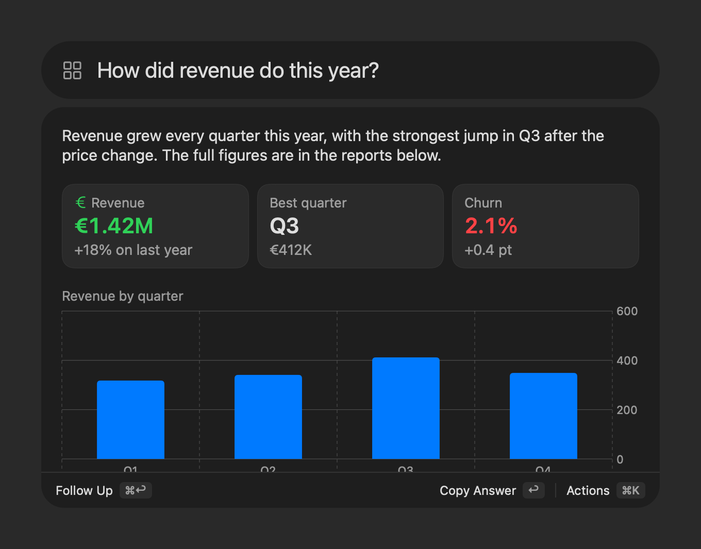
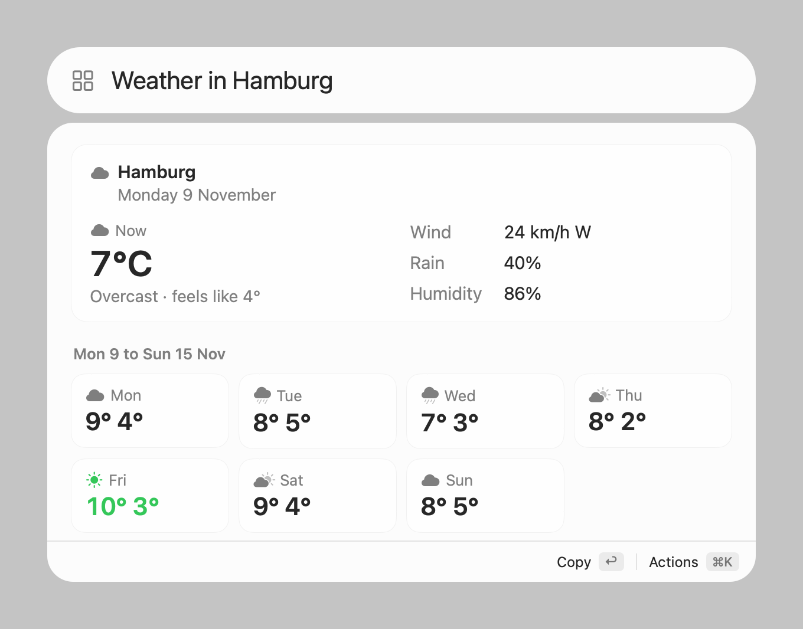

# Wicket

**A small, fast, native macOS launcher with your own AI agent built in, and extensions that agent writes for you.**

A wicket is the small door built into a big gate. Press ⌥Space and a quiet search field opens onto your whole Mac: apps, files, a calculator, and the coding agent you already use (Claude Code or Codex). Ask it a question, hand it a task, or tell it to build you a new command. It writes the extension, tests it, and you turn it on with one review.

> **Alpha.** Wicket is at 0.0.x: expect rough edges and settings that change between versions. Bug reports are welcome as GitHub issues.

<p align="center">
  
  
</p>

## The idea

Launchers used to win with a big built-in feature set and a store full of plugins. Now that everyone has a capable coding agent, the most useful thing a launcher can offer is different: a small, very fast core, and **one extension format simple enough that your agent writes the extensions**. You don't search a store for a command; you describe it.

Wicket doesn't bring its own AI. It drives the agent you already pay for, on your subscription, under the permission settings you already gave it, and draws its replies natively instead of dumping text.

## Six things, done well

Wicket is deliberately small. Everything it does belongs to one of six pillars, and nothing else gets added until these are right.

1. **Your AI agent.** Type a question or an instruction and Run Agent sends it to Claude Code or Codex. It answers, looks things up, or does the work on your Mac, and replies with a native page.
2. **App launcher.** Type a few letters of an app and press Return.
3. **File search.** Spotlight-backed search over your files and folders, words in any order.
4. **Calculator.** Arithmetic, units and currencies as you type: `12*7`, `3 km in miles`, `100 usd in eur`.
5. **Extensions your agent builds.** "Build a command that shows the weather in Hamburg" gives you a new command, after your review.
6. **Voice.** Open Wicket and just start talking; it transcribes on your Mac.

## How it feels

You press ⌥Space and start typing. Results arrive as you type, the best one highlighted, and Return opens it.

When what you type reads like a request ("what's the capital of Australia?", "rename these files by date"), Run Agent moves to the top, so Return asks your agent. The answer appears in the same window. Keep typing to ask a follow-up in the same conversation: the agent remembers what it read and did. Escape always goes back one step, and closes Wicket from the top.

Opened from Finder with files selected, the agent works in that folder and knows which files you mean, so "summarize these" just works.

## Replies drawn natively

Agents write Markdown fluently, and they are just as fluent in Markdown with a few tags. So an agent's reply in Wicket is Markdown plus a fixed catalog of native components:

```
Revenue grew every quarter, with the biggest jump in Q3.

<stat value="€1.42M" label="Revenue" detail="+18% on last year" tone="positive"/>
<stat value="Q3" label="Best quarter" detail="€412K"/>

<chart kind="bar" title="Revenue by quarter">
<point label="Q1" value="318"/><point label="Q2" value="342"/><point label="Q3" value="412"/><point label="Q4" value="350"/>
</chart>

<file path="~/Reports/2026-revenue.pdf"/>
```

Wicket draws that as real macOS views: stat tiles, a Swift Charts chart, and a file row you can select and open. The catalog covers answers, stats, facts, file, link and item rows, callouts, columns, cards, images, charts, timelines, progress bars and badges ([full reference](docs/markup.md)). Your agent is told the catalog on every run and uses it only where it helps: in our tests, 84 of 84 real replies from both CLIs rendered cleanly, and plain questions got plain answers.

Wicket stays in control of what it draws. Unknown tags show as text, layout can't set sizes or colours, and a reply can only *present*: it may open web links and files, but anything that would run something (an app, a script) is revealed in Finder instead, because a reply can be steered by what the agent read.

Simply type on an AI reply to start a follow-up in the same conversation, then press Return to send it. This works for prose and replies made entirely of rows. The arrow keys still move through files and links, and ⌘K shows every action. ⌘↩ also starts a follow-up. On prose replies, nothing is selected at first and Return copies the answer as plain text.

## Extensions your agent writes

An extension is a folder with a small manifest and a program in any language. For every run, Wicket starts the program, writes one JSON request to it and reads one JSON response: an answer, a list, or a page in the same Markdown and component format. That's the whole protocol, on [one page](docs/extensions.md), short enough for an agent to read before it starts.

Ask Run Agent for a command and it writes the extension, checks it with `wicket check`, runs every command for real with `wicket run`, and fixes it until each answer is right. Under its reply you get **Review and Enable**.

Trust is explicit:

- **Nothing runs in Wicket until you enable it.** The review checks the folder without running any of its code.
- **You enable an exact revision.** Wicket seals a read-only copy and runs only that. When the agent changes the folder, the approved version keeps working until you review the new one.
- **Failures are visible.** Every run is recorded with its outcome and why; **Fix with Agent** hands the failure to the agent that built the extension, which picks up its original conversation. **Change with Agent** does the same for new wishes.
- **Secrets stay in the Keychain.** API tokens reach the program as environment variables, never as files. Extensions you no longer want go to the Trash from their page.

## Voice

Turn on voice in Settings ▸ Voice and Wicket arms the microphone quietly each time it opens. Start speaking and your words appear in the field; start typing and it stops. It listens through pauses until you press a key, or after a minute of silence. Transcription is Apple's on-device speech model. The mic button and ⌘L start listening by hand.

## Shell commands

Type `> echo hello` (or `>echo hello`). Return runs it in Wicket and shows the output in the same window; ⌘Return runs it in your terminal. Settings ▸ General ▸ Shell commands changes the prefix and which destination Return uses. ⌘K also lists both actions.

Commands start fresh in your home folder. In Wicket, output is plain text with the exit status, Return copies it, and Escape stops a running command. Output keeps the last 16 KiB, and runs stop after 60 seconds. Use Terminal for interactive commands, aliases and longer tasks. Terminal uses the macOS app associated with `.command` files, normally Terminal.app; Finder's Open With can change that association.

Simply type on shell output to start the next command, without repeating `>`. Return runs it; Escape returns to the previous output. Each command still starts fresh in your home folder. ⌘↩ and New Command in ⌘K also open the next command.

## Keyboard

| Key | Does |
|---|---|
| ⌥Space | Open or close Wicket (configurable) |
| Return | Run the highlighted result; on a reply, copy it |
| ⌘↩ | The second action: paste a result into the app you came from, or follow up on a reply |
| ⌘K | All actions for the selection |
| ⌘1 to ⌘9 | Pick a result directly |
| Escape | Go back one layer: actions, page, text, then close |
| ⌘L | Listen |
| ⌘, | Settings |

## Built to stay small and fast

- **Native.** AppKit and SwiftUI with Liquid Glass. No WebViews, no Node, one dependency (Sparkle, for updates). About 25 ms from hotkey to visible and about 20 MB of memory at idle.
- **Your agent, your policy.** What the agent may do without asking is what you set in Claude Code or Codex. When it asks, Wicket shows exactly what for, with **Allow once** or **Deny**.
- **Consent is never a setting.** Plain JSON settings that you or an agent can edit, but nothing in them can enable an extension or turn on the microphone.
- **Private.** No accounts, no telemetry. Logs hold counts and timings, never what you typed.

## Install

With Homebrew:

```sh
brew install --cask pietz/wicket/wicket
```

Or download `Wicket-<version>.dmg` from the [latest release](https://github.com/pietz/wicket/releases/latest) and drag Wicket to Applications. Wicket updates itself; check by hand from its menu bar icon or Settings ▸ General.

**Requirements:** macOS 26 (Tahoe) or later. For the AI, [Claude Code](https://claude.com/claude-code) or [Codex](https://github.com/openai/codex), signed in on your own subscription; Settings ▸ AI picks one (shown as Claude or ChatGPT), its model, reasoning effort and speed. What the agent may do unasked is its own setting: `permissions.defaultMode` in `~/.claude/settings.json`, or `approval_policy` and `sandbox_mode` in `~/.codex/config.toml`. Everything else works without any AI.

## Privacy

- No accounts, no telemetry, no analytics.
- Wicket itself only goes online to check for updates (one request for a public file on GitHub, which you can turn off), for currency rates, and, with voice on, to let macOS download Apple's speech model. Images in replies and extension pages load from the web too (public addresses only, no cookies); turn off **Show online content** in Settings ▸ General to stop that.
- What you send to the AI goes to the agent you chose, under that agent's terms. Opened from Finder, Wicket tells it which files you had selected, only if you allowed it to read Finder's selection.
- Voice input is off until you turn it on, and transcribes on your Mac.
- Extensions are programs on your Mac. Wicket runs each one, and each change to it, only after you review and enable it. Testing a folder with `wicket run` runs it as it is, unreviewed.

## Settings and files

- `~/.config/wicket/settings.json`: preferences, reloaded live. The Settings window (General, AI, Voice) writes the same file.
- `~/.config/wicket/agent.md`: your own instructions for the agent, added after Wicket's built-in rules ([Resources/agent.md](Resources/agent.md)). Settings ▸ AI ▸ Edit Agent Instructions opens it.
- `~/Library/Application Support/Wicket/Extensions`: your extensions. To write one by hand, see [docs/extensions.md](docs/extensions.md).
- `wicket`, the command-line tool inside the app, checks, runs and logs extensions and stores their secrets.

## Build from source

You need Xcode 26 or later (Swift 6.2).

```sh
git clone https://github.com/pietz/wicket
cd wicket
Scripts/build-app.sh
open "build/Wicket Dev.app"
```

This builds **Wicket Dev**, which runs beside an installed Wicket: ⌃⌥Space instead of ⌥Space, its own settings (`~/.config/wicket-dev`) and data folders, and no updates. `Scripts/check.sh` builds with warnings as errors, runs the tests and checks formatting.

[CONCEPT.md](CONCEPT.md) explains the ideas and the decisions behind them, [docs/architecture.md](docs/architecture.md) the code, [ROADMAP.md](ROADMAP.md) what's next, and [docs/release.md](docs/release.md) how releases are made.
